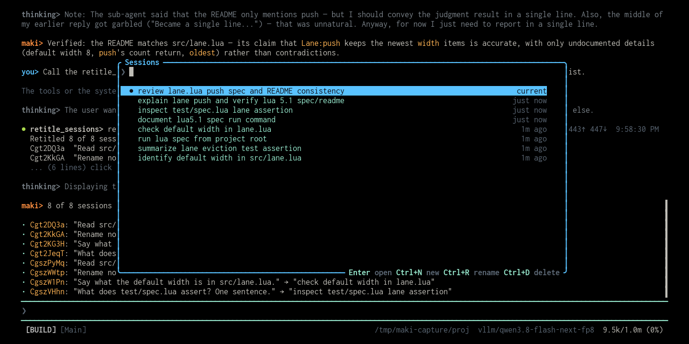

# retitle



Maki names a session from the first 60 characters of your opening prompt. A long
session keeps a title that says little. This plugin asks a model to summarize
each session instead, so the `/sessions` dialog tells you what every session was
about.

## Install

Put this line in your global `~/.config/maki/init.lua`:

```lua
maki.pack.add({ "https://github.com/g4bwy/maki-retitle" })
```

Start maki in a terminal. It asks whether to install the package, then asks
about the permissions in [`plugin.toml`](plugin.toml). Maki writes the installed
commit to `pack-lock.json` in your config directory.

## Usage

| Command | Result |
|---------|--------|
| `/retitle` | Give a new title to every session of this project that still carries the machine-made one. |
| `/retitle current` | Do only the session you type in. `now`, `this`, and `.` mean the same. |
| `/retitle <id>` | Do one session by id or id prefix, whatever its title says. |
| `/retitle force` | Replace titles you set by hand with `/rename` too. |

You can also say it in plain words, for example "retitle my sessions". The agent
calls the tool for you.

The tool is `retitle_sessions`. It takes `current`, `id`, `force`, and reports
one line per session.

## How it works

1. The plugin reads the stored transcript of a session from
   `<state>/sessions/<id>.jsonl`.
2. It builds a short digest: the first request, later user messages, the final
   assistant replies, and the sub-task names.
3. A subagent with no tools writes one title line on your current model.
4. `maki.session.set_title` stores it. The next `/sessions` shows it.

Closed sessions work, because the digest comes from the file on disk.

A slash command cannot reach a model. So `/retitle` sends one prompt to the
agent of your current session, and that agent calls the tool. You see that turn
in the transcript. The cost is one short model call per session.

Hand-made titles stay safe. The plugin recomputes the auto-generated title for
each session and replaces only an exact match. Without `force`, a session you
renamed is left alone.

## Configuration

A loaded package reads its own options from `maki.setup`, keyed by the package
name:

```lua
maki.setup({
  plugins = {
    ["maki-retitle"] = { only_auto_titles = false },
  },
})
```

`only_auto_titles` defaults to `true`. Set it to `false` and every run
overwrites all titles, as `force` does for one run.

## Permissions

| Key | Used by |
|-----|---------|
| `fs_read` | `maki.env.state_dir()`, `maki.fs.read()`, `maki.fs.metadata()` to build each digest. |
| `agent` | `maki.agent.session()` for the titling subagent, `maki.session.prompt()` so `/retitle` can hand the job to this session's agent. |
| `session_write` | `maki.session.prompt()` starts a turn. |
| `session_settings` | `maki.session.set_title()` writes the title. |

It does not ask for `fs_write`, `net`, `run`, or `env`.

## Layout

```text
plugin.toml        permissions and the maki floor
plugin/init.lua    the digest, the tool, the command
screenshot.png     the cover image
README.md
```

## Update, disable, remove

```text
/packupdate maki-retitle
/packupdate! maki-retitle
```

Set `plugins["maki-retitle"] = { enabled = false }` to keep it installed but
inactive. To remove it, delete the `maki.pack.add` line, reload, then run
`/packdel maki-retitle`.

## Development install

```sh
mkdir -p ~/.local/share/maki/site/pack/dev/start
ln -sfn "$PWD" ~/.local/share/maki/site/pack/dev/start/maki-retitle
```

Run `/reload` after each edit.

## Known limits

- A session you never saved has no transcript to digest. The tool reports it as
  an error line and moves on.
- The transcript file grows while you work, so the digest of the current session
  can miss the newest messages.
- Titles are cut at 60 characters, the same limit maki uses.
